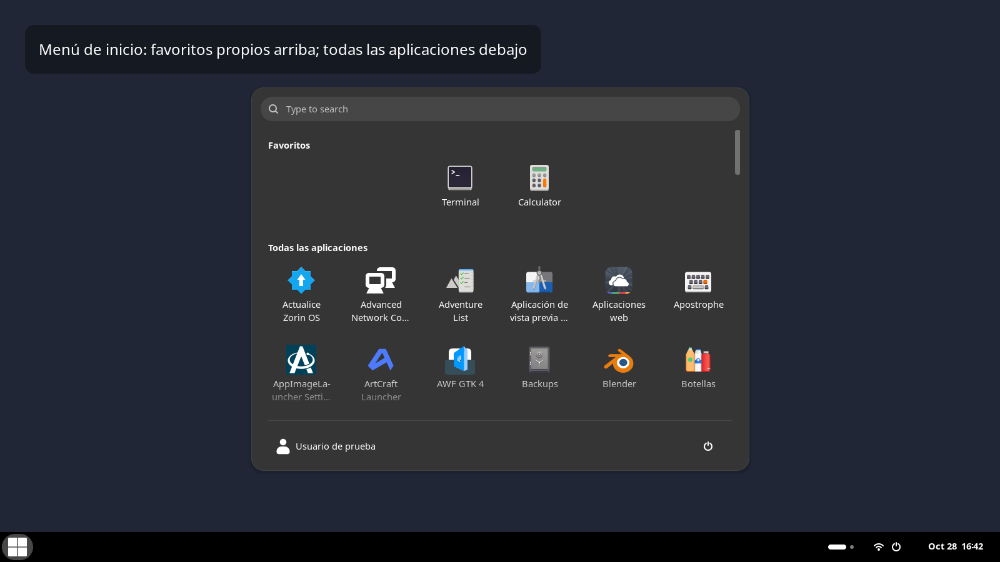
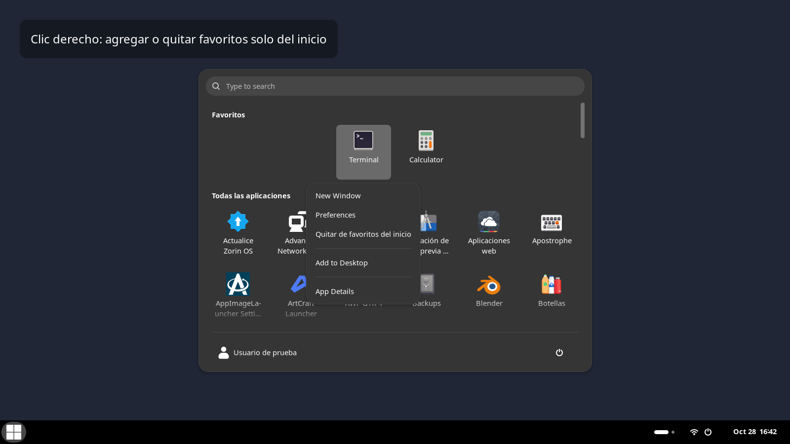
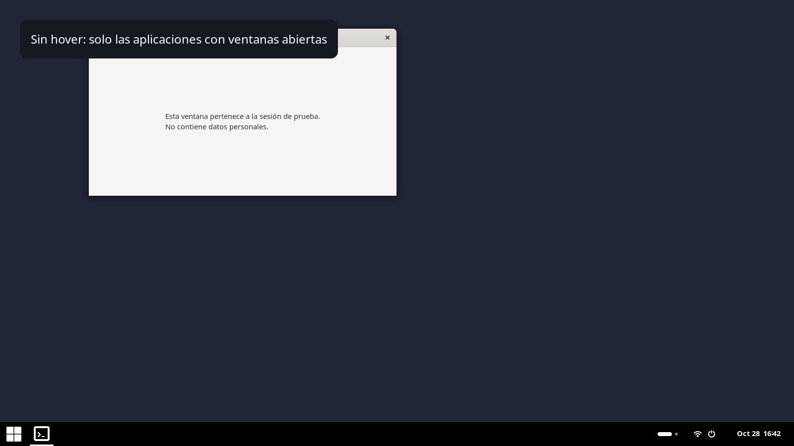
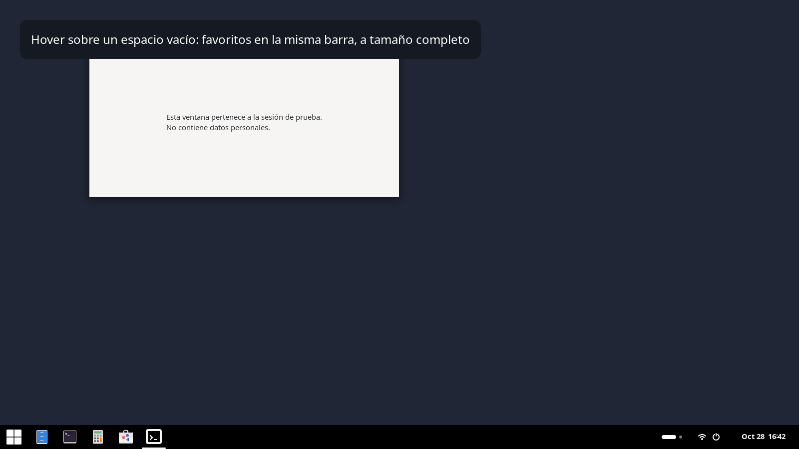
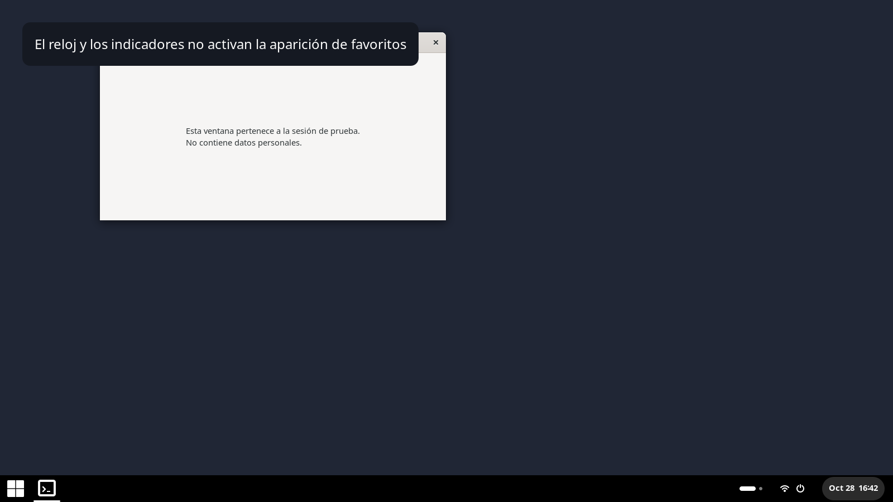
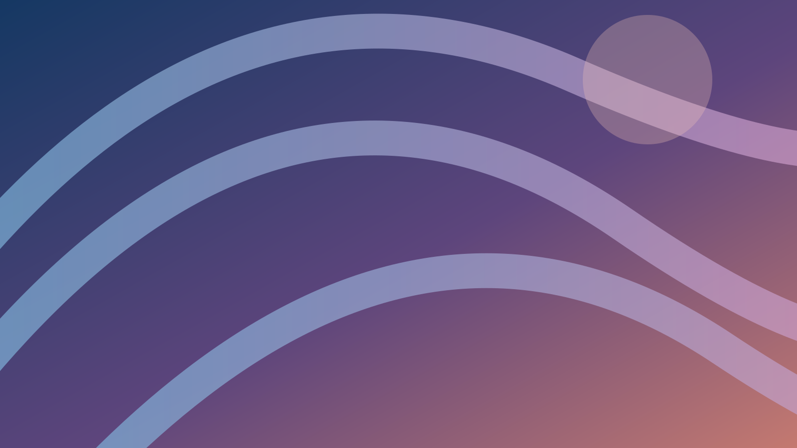

# Capturas explicadas

Las capturas muestran la implementación instalada en una sesión GNOME 46 **aislada**, con fondo neutro, una ventana de demostración y listas de favoritos de prueba. El nombre y el avatar del usuario se sustituyen en la interfaz de prueba. No son imágenes generadas con IA ni capturas de ventanas personales. Algunos iconos del catálogo de aplicaciones pertenecen a paquetes instalados en el equipo anfitrión.

## 1. Inicio con favoritos independientes

El menú está centrado horizontal y verticalmente, independientemente de la posición del botón de inicio. La sección superior usa su propio almacenamiento. Debajo permanece la lista completa. Los favoritos elegidos para esta captura difieren de los de la barra para mostrar la independencia de las dos listas.

## 2. Acción del menú de inicio

La acción añadida menciona explícitamente **favoritos del inicio**. La acción heredada que modificaría los favoritos del dash se oculta en este menú.

## 3. Barra en reposo, con una ventana abierta

El puntero está fuera de la barra. Solo aparece el icono de la ventana de demostración. Las aplicaciones minimizadas también cuentan como abiertas; los lanzadores sin ventanas quedan ocultos.

## 4. Favoritos sobre la misma barra

Mover el puntero a un espacio vacío revela los favoritos junto a la aplicación abierta. No hay botón `+` ni panel desplegable. La captura se toma después de completar la animación y asentar el tamaño de los iconos.

## 5. Controles excluidos

Tras ocultar los favoritos, se mueve el puntero al reloj y se comprueba que no los revele. La misma exclusión por grupos se aplica a inicio, mostrar aplicaciones e indicadores.

## 6. Fondo nítido de referencia

## 7. Mismo fondo con desenfoque del bloqueo

Las dos últimas imágenes se renderizan con el motor de GNOME a partir del SVG geométrico incluido en [demo-wallpaper.svg](demo-wallpaper.svg). Se usan radio 0/brillo 1 para la referencia y radio 90/brillo 0,65 para el desenfoque. Son capturas del **fondo**, no una fotografía del inicio de sesión con un usuario real. El PNG desenfocado es el tipo de imagen que instala `wallpaper.py` en GDM.

El wallpaper personal del equipo original no se distribuye. En tu equipo puedes usar cualquier imagen para la que tengas permiso.
